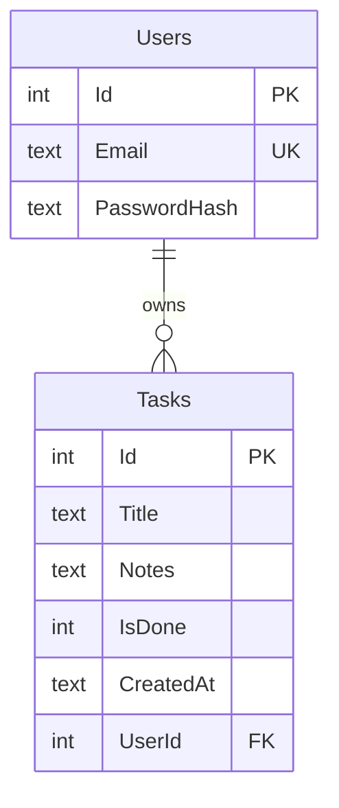

# Task Notebook database reference

The app uses **EF Core code-first**: the tables are generated from the classes in `Models.cs` the first time the app runs (`EnsureCreated()` in `Program.cs`). The default database is **SQLite**, stored in the file `taskapp.db` next to the project (set by `ConnectionStrings:Default` in `appsettings.json`).

## Entity relationship



One user owns many tasks. Every task belongs to exactly one user.

## Table: `Users`

| Column | SQLite type | Null? | Notes |
|---|---|---|---|
| `Id` | INTEGER | No | Primary key, auto-increment |
| `Email` | TEXT | No | Stored trimmed and lowercased. Unique |
| `PasswordHash` | TEXT | No | BCrypt hash. The plain password is never stored |

**Indexes:** `IX_Users_Email` (unique), which also enforces one account per email.

## Table: `Tasks`

| Column | SQLite type | Null? | Notes |
|---|---|---|---|
| `Id` | INTEGER | No | Primary key, auto-increment |
| `Title` | TEXT | No | Required. Validated in the API |
| `Notes` | TEXT | Yes | Optional free text |
| `IsDone` | INTEGER | No | Boolean stored as `0` (open) or `1` (done) |
| `CreatedAt` | TEXT | No | UTC timestamp, set when the row is created |
| `UserId` | INTEGER | No | Foreign key to `Users.Id` |

**Indexes:** `IX_Tasks_UserId` (created automatically for the foreign key).
**Foreign key:** `UserId` references `Users(Id)` with **ON DELETE CASCADE**, so deleting a user also deletes all of their tasks.

## Equivalent SQL

This is roughly what EF Core generates for SQLite:

```sql
CREATE TABLE "Users" (
    "Id"           INTEGER NOT NULL CONSTRAINT "PK_Users" PRIMARY KEY AUTOINCREMENT,
    "Email"        TEXT    NOT NULL,
    "PasswordHash" TEXT    NOT NULL
);

CREATE TABLE "Tasks" (
    "Id"        INTEGER NOT NULL CONSTRAINT "PK_Tasks" PRIMARY KEY AUTOINCREMENT,
    "Title"     TEXT    NOT NULL,
    "Notes"     TEXT    NULL,
    "IsDone"    INTEGER NOT NULL,
    "CreatedAt" TEXT    NOT NULL,
    "UserId"    INTEGER NOT NULL,
    CONSTRAINT "FK_Tasks_Users_UserId" FOREIGN KEY ("UserId")
        REFERENCES "Users" ("Id") ON DELETE CASCADE
);

CREATE UNIQUE INDEX "IX_Users_Email"  ON "Users" ("Email");
CREATE INDEX        "IX_Tasks_UserId" ON "Tasks" ("UserId");
```

## Useful queries

```sql
-- All users
SELECT Id, Email FROM Users;

-- Tasks for one user, newest first
SELECT Id, Title, IsDone, CreatedAt
FROM Tasks
WHERE UserId = 1
ORDER BY CreatedAt DESC;

-- Task count per user
SELECT u.Email, COUNT(t.Id) AS TaskCount
FROM Users u
LEFT JOIN Tasks t ON t.UserId = u.Id
GROUP BY u.Id;

-- Open vs done
SELECT IsDone, COUNT(*) FROM Tasks GROUP BY IsDone;
```

## How to inspect the database

- **DB Browser for SQLite** (free GUI): open `taskapp.db` and browse the tables.
- **VS Code:** install the "SQLite Viewer" extension and open the file.
- **Command line:** `sqlite3 taskapp.db`, then `.tables` and `.schema`.

Stop the app before editing the file with a tool, or you may hit a "database is locked" error.

## Resetting the database

Stop the app, delete `taskapp.db`, and run it again. Empty tables are recreated. This is the only way to apply model changes while the app uses `EnsureCreated()`, because that call never alters tables that already exist.

## Moving to SQL Server

The model is the same, but the column types change:

| C# property | SQLite | SQL Server |
|---|---|---|
| `int Id` | INTEGER | `int IDENTITY` |
| `string` (required) | TEXT | `nvarchar(max) NOT NULL` |
| `string?` | TEXT NULL | `nvarchar(max) NULL` |
| `bool IsDone` | INTEGER (0/1) | `bit` |
| `DateTime CreatedAt` | TEXT | `datetime2` |

Tip: `Email` as `nvarchar(max)` can't carry a unique index in SQL Server. Before switching, limit the length in `AppDb.OnModelCreating`:

```csharp
b.Entity<User>().Property(u => u.Email).HasMaxLength(256);
```

See `README.md` for the full switch steps.

## Next step: migrations

`EnsureCreated()` is fine for learning, but real projects use migrations so schema changes are tracked and applied without deleting data:

```powershell
dotnet tool install --global dotnet-ef
dotnet add package Microsoft.EntityFrameworkCore.Design --version 8.0.*
dotnet ef migrations add InitialCreate
dotnet ef database update
```

Then remove the `EnsureCreated()` line from `Program.cs`. If a `taskapp.db` created by `EnsureCreated()` already exists, delete it first.

## Security notes

- Passwords are stored only as BCrypt hashes, but the file still contains emails, so keep `taskapp.db` out of source control. Add `*.db` to `.gitignore`.
- Every task query in the API filters by the logged-in user's `UserId`, which is what keeps users' data separate.
